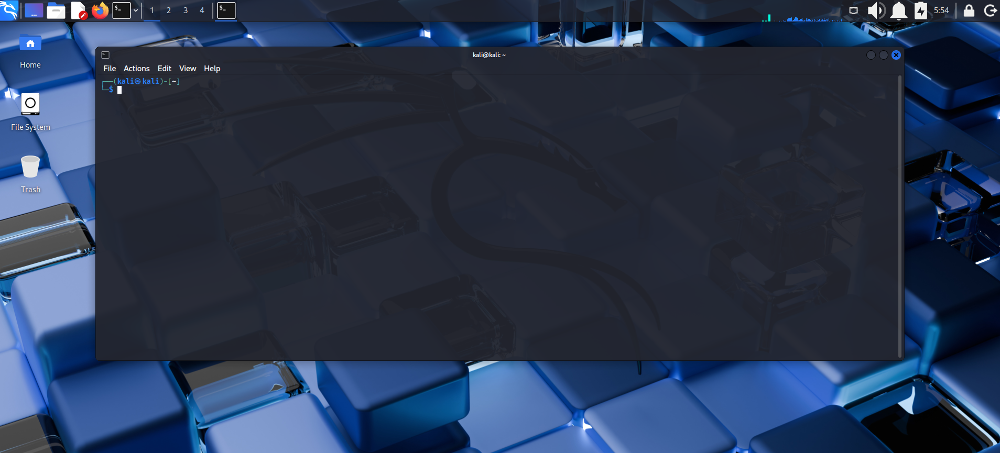
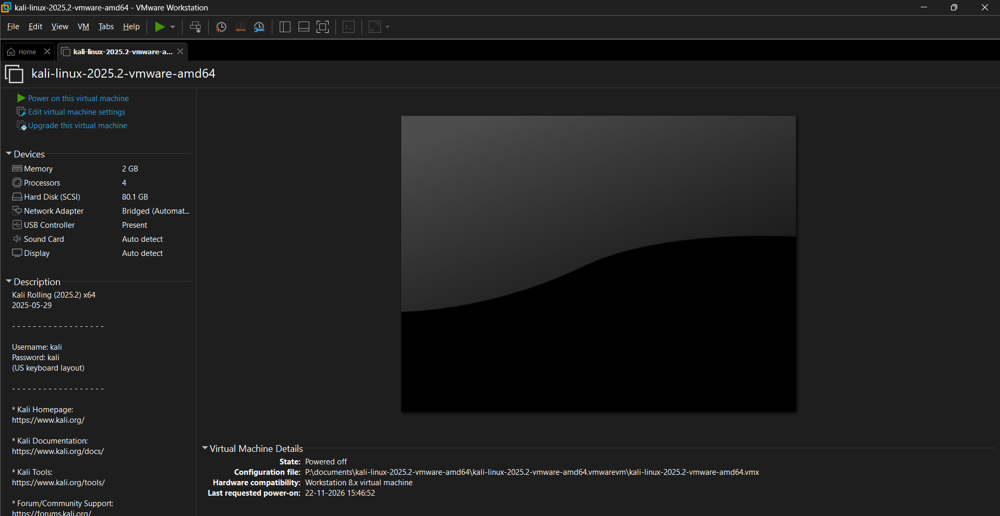
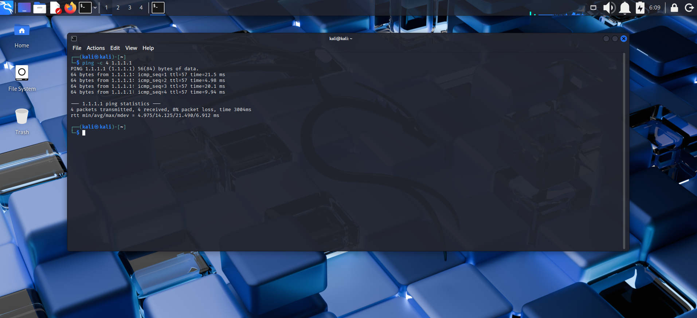

# kali-linux-setup
Week 1 Cybersecurity Internship - Kali Linux Installation and Setup

 <h1 align="center">🔐 Kali Linux Lab Setup</h1>

<hr>

<h2 align="center">NETWORKWALKS · CYBERSECURITY INTERNSHIP · WEEK 01</h2>

<p align="center">
  <strong>Building my cybersecurity foundation, one lab at a time.</strong>
</p>

<p align="center">
  A documented setup of my Kali Linux virtual machine using VMware Workstation Pro on Windows.
</p>

<br>

<p align="center">
  
  
  
  
</p>

<hr>

## 📌 Table of Contents

1. [🎯Project Overview](project-overview)
2. [🛠️Lab Environment](#lab-environment)
3. [⚙️Hardware Configuration](#hardware-configuration)
4. [🚀 Setup Process](#setup-process)
5. [🌐 Internet Connectivity Test](#internet-connectivity-test)
6. [📸 Screenshots](#screenshots)
7. [✅ Week 1 Checklist](#week-1-checklist)
8. [📚 Key Learnings](#key-learnings)
9. [👩‍💻 Author](#author)
---

## 🎯 Project Overview

The objective of this task was to set up and run a functional Kali Linux virtual machine as the foundation for hands-on cybersecurity learning.

I installed Kali Linux using VMware Workstation and verified that the virtual machine boots successfully and has internet connectivity.

### Objectives

- Install Kali Linux in a virtualized environment.
- Explore the Kali Linux desktop environment.
- Understand basic Linux terminal usage.
- Check system information and kernel version.
- Explore VMware hardware configuration.
- Test internet connectivity.
- Document the setup with screenshots.

---

## 🛠️ Lab Environment

| Component | Configuration |
|---|---|
| Task | Week 1 — Kali Linux Lab Setup |
| Host Operating System | Windows |
| Virtualization Software | VMware Workstation Pro |
| Guest Operating System | Kali Linux |
| Kernel Version | 6.12.25-amd64 |
| Architecture | x86_64 |
| Desktop Environment | XFCE |
| Terminal | XFCE Terminal |
| Internet Connectivity | Tested using Ping |

---

## ⚙️ Hardware Configuration

The Kali Linux virtual machine includes the following virtual hardware components:

| Component | Description |
|---|---|
| Memory | Allocated RAM |
| Processors | Virtual CPU configuration |
| Hard Disk | Virtual storage |
| Network Adapter | Virtual network connection |
| Display | Virtual display configuration |

These settings can be viewed through the VMware virtual machine settings.

---

## 🚀 Setup Process

### Step 1 — Download Kali Linux

Downloaded the Kali Linux installation image from the official website.

Official Download Page: https://www.kali.org/get-kali/

### Step 2 — Install VMware Workstation

Installed VMware Workstation to create and manage the Kali Linux virtual machine.

### Step 3 — Configure the Virtual Machine

Selected the Kali Linux installation image and configured the virtual machine hardware settings.

### Step 4 — Boot Kali Linux

Started the virtual machine and successfully accessed the Kali Linux desktop environment.

### Step 5 — Explore the Terminal

Opened the Kali Linux terminal and explored basic Linux commands.

### Step 6 — Check System Information

Used the following command to check the Linux kernel version and system architecture:

```bash
uname -a
```

---

## 🌐 Internet Connectivity Test

To verify internet connectivity from Kali Linux, I used the following command:

```bash
ping -c 4 1.1.1.1
```

This command sends four ICMP echo requests to Cloudflare's public DNS IP address.

### Expected Result

Successful connectivity typically produces replies similar to:

```text
64 bytes from 1.1.1.1: icmp_seq=1 ttl=... time=... ms
64 bytes from 1.1.1.1: icmp_seq=2 ttl=... time=... ms
64 bytes from 1.1.1.1: icmp_seq=3 ttl=... time=... ms
64 bytes from 1.1.1.1: icmp_seq=4 ttl=... time=... ms
```

Successful replies indicate that the virtual machine can communicate with the target IP address.

---

## 📸 Screenshots

The following screenshots document my Kali Linux installation and lab configuration.

### 1. Kali Linux Desktop

Shows the Kali Linux desktop environment running inside VMware.


### 2. Terminal

Shows the Kali Linux terminal environment.



### 3. System Information

Shows the kernel version and system architecture using the `uname -a` command.


### 4. VMware Settings

Shows the virtual machine settings in VMware Workstation.



### 5. Hardware Settings

Shows the virtual hardware configuration of the Kali Linux virtual machine.


### 6. Internet Connectivity

Shows the output of the internet connectivity test using `ping -c 4 1.1.1.1`.



---

## ✅ Week 1 Checklist

- [x] Downloaded Kali Linux.
- [x] Installed Kali Linux using VMware.
- [x] Successfully booted the virtual machine.
- [x] Accessed the Kali Linux desktop.
- [x] Explored the Linux terminal.
- [x] Checked system information.
- [x] Explored VMware settings.
- [x] Checked virtual machine hardware configuration.
- [x] Tested internet connectivity.
- [x] Documented the setup with screenshots.

---

## 📚 Key Learnings

Through this task, I gained practical experience with:

- **Virtualization:** Understanding how an operating system runs inside a virtual machine.
- **Kali Linux:** Exploring the Linux desktop environment.
- **Linux Terminal:** Understanding basic terminal usage.
- **System Information:** Learning how to check kernel and architecture details.
- **VMware:** Understanding virtual machine hardware configuration.
- **Networking:** Testing IP connectivity using the ping command.
- **Documentation:** Learning how to document technical work using GitHub.

---

## 👩‍💻 Author

**Sufiyan Pathan**

Cybersecurity Learner

Cybersecurity Internship — Week 1

---

<p align="center">
  <strong>🔐 LEARN · PRACTICE · DOCUMENT · IMPROVE</strong>
</p>

<p align="center">
  Building a strong foundation in cybersecurity.
</p>
